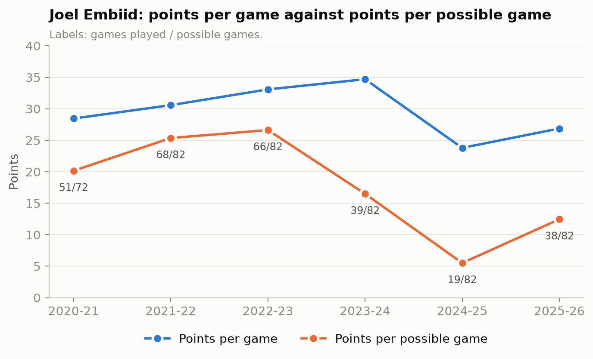
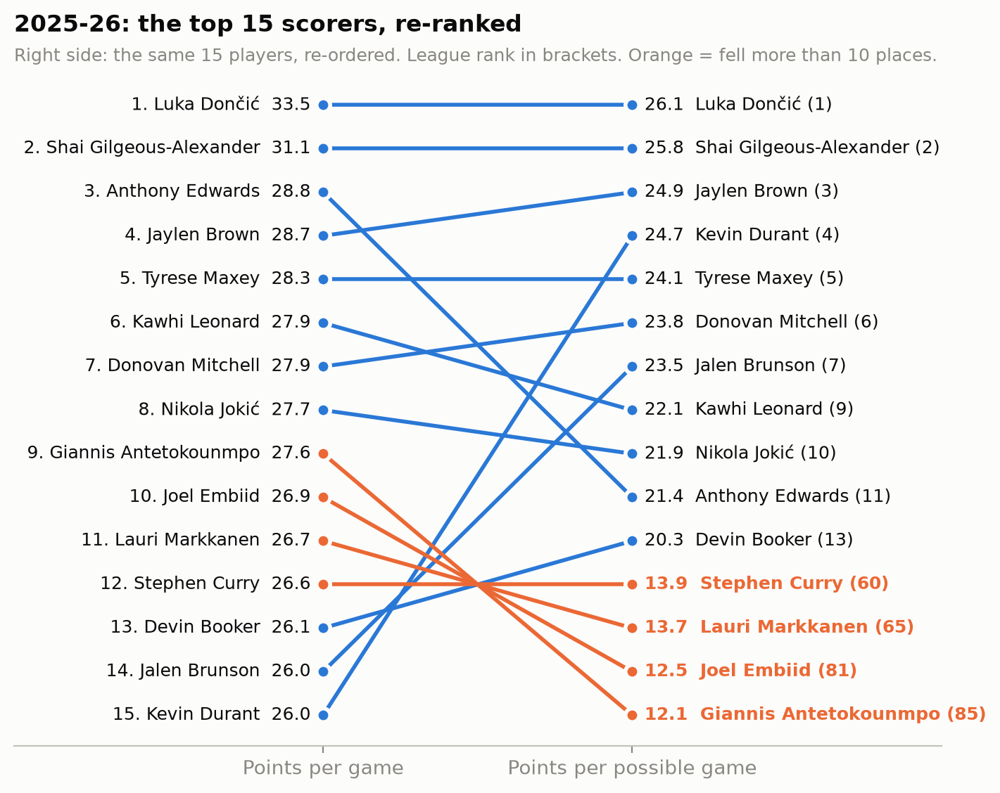
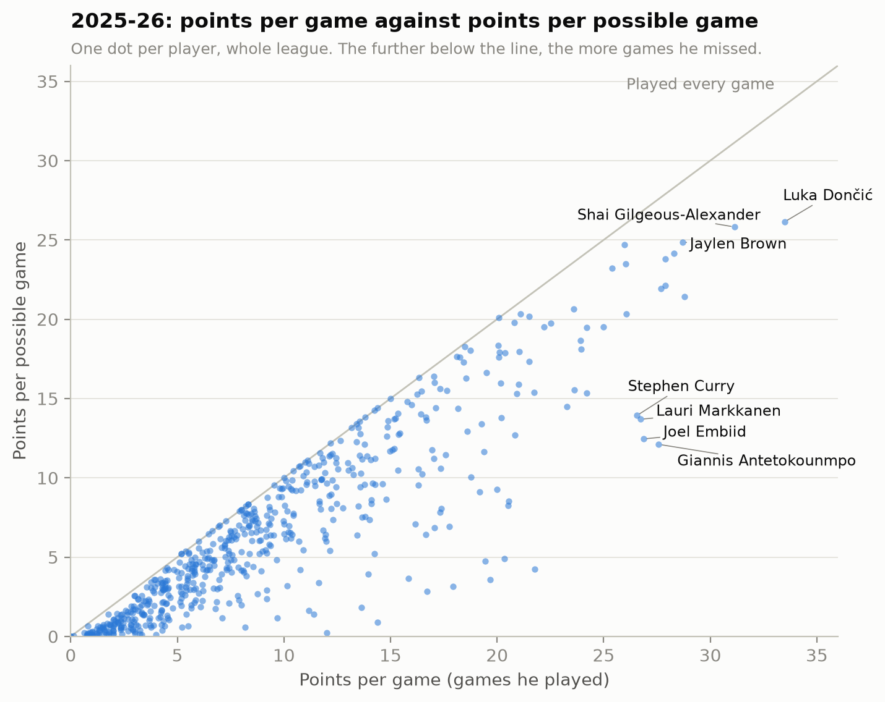

# Possible Value: points per possible game

How much is a great scorer worth if he often doesn't play?

Points per game only counts the games a player plays. This project also counts the games he **could** have played: every game his team played while he was on the roster, from his NBA debut on. Missed games count whatever the reason: injury, rest or suspension.

## The measure

**PPPG (points per possible game)** = a player's points for the season ÷ his possible games.

| Measure | What it means | Counts missed games? |
|---|---|---|
| PPG | Points per game he played | No |
| PPPG | Points per game his team played while he was on the roster | Yes |
| PPM | Points per minute he played | No |
| PPPM | Points per minute he could have played (48 a game, every possible game) | Yes |

A player who plays every game has the same PPG and PPPG. The more he misses, the further his PPPG falls below his PPG. The idea works for any stat (rebounds, assists and so on), so the project calls the family **XPPG**.

## Findings: Model 1 (points only)

*24 November 2026. Regular seasons 2020-21 to 2025-26, whole league, no minimum games.*

**1. Joel Embiid won three straight scoring titles, but none of the three points-per-possible-game titles.**

| Season | PPG leader | PPG | PPPG leader | PPPG | Embiid's PPPG rank |
|---|---|---|---|---|---|
| 2021-22 | Joel Embiid | 30.6 | Trae Young | 26.3 | 3rd |
| 2022-23 | Joel Embiid | 33.1 | Jayson Tatum | 27.1 | 2nd |
| 2023-24 | Joel Embiid | 34.7 | Luka Dončić | 28.9 | 48th |

In 2023-24 he played 39 of the 76ers' 82 games. Over those 82 games he gave them 16.5 points a game, 48th in the league. In 2024-25 he played 19 games: 23.8 points per game, but 5.5 per possible game (258th).



**2. In 2025-26, four of the top 12 scorers fell outside the top 50 once missed games counted.**

| Player | Played | PPG (rank) | PPPG (rank) |
|---|---|---|---|
| Giannis Antetokounmpo | 36 of 82 | 27.6 (9th) | 12.1 (85th) |
| Joel Embiid | 38 of 82 | 26.9 (10th) | 12.5 (81st) |
| Lauri Markkanen | 42 of 82 | 26.7 (11th) | 13.7 (65th) |
| Stephen Curry | 43 of 82 | 26.6 (12th) | 13.9 (60th) |

Kevin Durant went the other way: 15th by points per game, 4th by points per possible game, from playing 78 of 82 games.



**3. The biggest fall in the six seasons:** Kyrie Irving in 2021-22. He was 8th in points per game (27.4) but 127th in points per possible game (9.7), after playing 29 of 82 games.

**4. When the scoring leader plays most of the season, nothing changes.** Stephen Curry (2020-21), Shai Gilgeous-Alexander (2024-25) and Luka Dončić (2025-26) led both lists.



**5. Points per minute adds little.** Points per possible minute puts players in exactly the same order as points per possible game. Points per minute played is topped by players with a handful of minutes.

## Caveats

- **Points are not wins.** Model 1 measures scoring only. Whether missed games cost wins is the next model.
- **Every missed game counts,** including rest days, suspensions and COVID-19 protocol absences (2020-21 and 2021-22).
- **Two-way players** are included but marked: their contracts limit how many NBA games they can play.
- **Traded players** can have more than 82 possible games, when their new team had played fewer games than their old one at the time of the trade.
- **17 of 3,950 player-seasons** have a join or leave date NBA.com doesn't record. They are marked, and their possible games stop at their last game.

Every rule, with its reason, is in [docs/DECISIONS.md](docs/DECISIONS.md).

## Notebooks

| Notebook | What it shows |
|---|---|
| [0_data](notebooks/0_data.ipynb) | The data, checked: team games, Embiid's seasons, players who missed whole seasons, and how player moves are dated |
| [1_possible_games](notebooks/1_possible_games.ipynb) | Possible games for every player, checked against well-known cases |
| [2_model_1](notebooks/2_model_1.ipynb) | Points per game against points per possible game, every season |
| [3_all_stats](notebooks/3_all_stats.ipynb) | Points, assists, rebounds, steals, blocks and stocks: top 10 per game against top 10 per possible game, every season |

## Data and reproducing

All data comes from NBA.com: game logs, rosters and team schedules through [nba_api](https://github.com/swar/nba_api), plus NBA.com's player-movement feed for the dates of trades, signings and waivers. Downloads are cached under `data/`, which is not in git.

```bash
python3.12 -m venv .venv
.venv/bin/pip install -r requirements.txt
.venv/bin/pip install -e .
```

Then run the notebooks in order.

## What's next

- From points to wins: does a high scorer who often misses games cost his team wins?
- Minute dominance: do stars who play heavy minutes take opportunities from teammates?
- An "efficient team" tested on a past season.
- Salaries: value for money.
